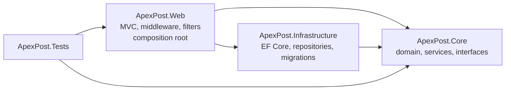
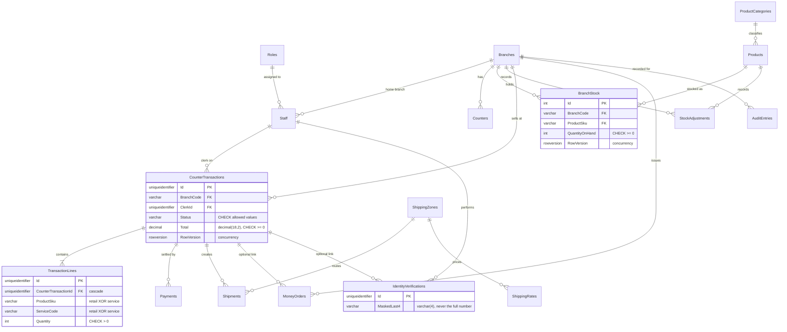

# ApexPost design and architecture

## 1. Current state and target

| Layer | Project today | Target (brief) |
|---|---|---|
| Domain | `ApexPost.Core/Domain` | `ApexPost.Domain`, references nothing |
| Application | `ApexPost.Core/Application` (interfaces, services) | `ApexPost.Application`, references Domain only |
| Infrastructure | `ApexPost.Infrastructure` (EF Core) | references Application and Domain |
| Web | `ApexPost.Web` (composition root) | references all |
| Tests | `ApexPost.Tests` | references all |

The Domain and Application code currently share one project, `ApexPost.Core`. The dependency rule inside it is enforced by convention, not by the compiler. Splitting it is the next structural step (see section 12).

Dependency direction (current, and the rule we keep):

Rules that the code follows:
- Domain code uses no EF or ASP.NET types.
- Application services depend only on interfaces defined in `Core/Application/Interfaces`.
- Repositories stage changes and never call `SaveChanges`. `IUnitOfWork.SaveChangesAsync` is the only commit.
- `DbContext`, repositories and the unit of work are scoped. There are no static or singleton contexts.

## 2. Entity-relationship diagram

Relationship labels say what they mean. Stock, sales and payment history are never deleted in the normal flow. The delete behaviour for each table is in section 4.

## 3. Normalization note: anomalies the design prevents

The schema is in third normal form, with two deliberate exceptions noted below.

1. **Update anomaly, role and category text.** Early drafts stored a role name on every staff row and a category name on every product row. Renaming a role would have meant editing many rows, and a typo would have created a second role. Now `Roles` and `ProductCategories` hold each value once, and `Staff.Role` and `Products.Category` are foreign keys to them.
2. **Insert anomaly, counters.** Counters were a JSON list on `Branches`. A counter could not be added, checked or referenced by a foreign key without rewriting the branch row. Now `Counters` has one row per counter, with a unique `(BranchCode, CounterCode)`.
3. **Delete anomaly, zones and rates.** Deleting a shipping zone would silently orphan its rates and shipments. Zones are referenced with restrict, so the database refuses the delete.

Two deliberate denormalizations, both intentional:
- `TransactionLines.UnitPrice` is a snapshot of the price at the time of sale. A later price change must not rewrite history.
- `CounterTransactions.SubTotal`, `TaxTotal` and `Total` are stored, not recomputed. Reports and receipts must agree with what was charged.

## 4. Keys and delete behaviour

| Table | Primary key | Foreign keys (delete behaviour) | Unique / check constraints | Audit columns |
|---|---|---|---|---|
| Branches | `Id` (guid), alternate key `Code` | none | `Code` unique | CreatedAtUtc, CreatedBy, ModifiedAtUtc, ModifiedBy |
| Counters | `Id` | `BranchCode` → Branches (restrict) | `(BranchCode, CounterCode)` unique | yes |
| Roles | `Id` (enum as string) | none | seeded | yes |
| ProductCategories | `Id` (enum as string) | none | seeded | yes |
| Staff | `Id` | `HomeBranch` → Branches, `Role` → Roles (restrict) | `Email` unique | yes |
| Products | `Id`, alternate key `Sku` | `Category` → ProductCategories (restrict) | `Sku` unique, `UnitPrice >= 0` | yes |
| BranchStock | `Id` | `BranchCode` → Branches, `ProductSku` → Products (restrict) | `(BranchCode, ProductSku)` unique, `QuantityOnHand >= 0`, `ReorderThreshold >= 0` | rowversion |
| StockAdjustments | `Id` (identity) | `BranchCode`, `ProductSku` (restrict) | `Delta <> 0` | yes; append-only |
| ShippingZones | `Id` (int) | none | `Code` unique | yes |
| ShippingRates | `Id` (int) | `ZoneId` → ShippingZones (restrict) | `(ZoneId, ServiceLevel, MaxWeightKg)` unique, `MaxWeightKg` in (0, 30] | yes |
| Shipments | `Id` | `CounterTransactionId`, `BranchCode`, `ZoneId` (restrict) | `TrackingReference` unique, `WeightKg` in (0, 30], `Price >= 0` | yes |
| CounterTransactions | `Id` | `BranchCode` → Branches, `ClerkId` → Staff (restrict) | `Total >= 0`, `Status` in allowed list | rowversion, yes |
| TransactionLines | `Id` | `CounterTransactionId` → CounterTransactions (**cascade**: dependent detail of an owned aggregate) | `Quantity > 0`, `UnitPrice >= 0`, exactly one of ProductSku or ServiceCode | yes |
| Payments | `Id` | `CounterTransactionId` (restrict) | `Amount > 0`, `Status` in allowed list | yes |
| MoneyOrders | `Id` | `BranchCode` → Branches (restrict), `TransactionId` → CounterTransactions (restrict, optional) | `Amount > 0`, `Fee >= 0`, `Status` in allowed list | yes |
| IdentityVerifications | `Id` | `StaffId` → Staff, `BranchCode`, `TransactionId` (restrict) | `MaskedLast4` is varchar(4) | yes |
| AuditEntries | `Id` | none, on purpose | none | append-only |

Why restrict almost everywhere. A sale, a payment or a stock change is evidence. Deleting its parent must fail, not remove the evidence. Corrections are made by voiding or refunding (status changes), not by deleting rows.

Why cascade for TransactionLines only. Lines belong to one transaction and have no meaning without it. They are part of the same aggregate.

Why no foreign keys on AuditEntries. Audit rows must survive anything, including the deletion of the rows they describe.

## 5. Concurrency

- `BranchStock` and `CounterTransactions` have `rowversion` columns. An update that finds a changed row fails with `DbUpdateConcurrencyException`, which the middleware returns as HTTP 409 (ADR-013).
- A counter sale decrements stock and saves the transaction, its lines and its payment in one `SaveChangesAsync` (`CheckoutService`, ADR-016). Either all of it is written or none of it is.
- Two clerks selling the last unit: the second commit fails with a conflict, so stock cannot go negative. The database test `Two_clerks_selling_the_last_unit_second_save_gets_a_concurrency_conflict` checks this.

## 6. Identity documents

Identity documents are masked in four places:
- **Domain:** `MaskedIdentifierPolicy` rejects all-digit values (they look like a full number) and enforces 4–20 characters.
- **Persistence:** `IdentityVerificationRecord.MaskedLast4` is varchar(4). The schema cannot hold more (ADR-015).
- **Audit:** the audit filter lists `documentNumber` among the redacted fields.
- **Logs:** EF sensitive-data logging is enabled only in Development, and it logs only what is sent to the database, which is the masked value.

## 7. Stored procedures and LINQ (ADR-010)

| Procedure | Why it is a procedure |
|---|---|
| `usp_DailyBranchSales` | A reporting contract with a fixed parameter list, used by the report screen and any future integration. Aggregation runs next to the data. Parameters are validated with `THROW`. |
| `usp_LowStockReport` | `@BranchCode` is optional, so the plan depends on the parameter. `OPTION (RECOMPILE)` gives a plan for each call (ADR-010). |
| `usp_AdjustStock` | A stock change and its history row must happen together. Keeping both in one procedure with `TRY…CATCH` and `XACT_ABORT` means a history row cannot exist without its stock change, even if another caller bypasses the application. |

Everything else (counter sales, lookups, screens) is LINQ, because it is easier to test and keeps the rules in C#.

## 8. Indexes

Index decisions are recorded in ADR-009 and measured in `PERFORMANCE.md`. Indexes already in the migrations:
- `BranchStock (BranchCode, ProductSku)` unique: stock lookup for a sale.
- `BranchStock (BranchCode, QuantityOnHand)`: low-stock report.
- `CounterTransactions (BranchCode, CreatedAtUtc)`: daily sales.
- `MoneyOrders (BranchCode, CreatedAtUtc)`: money-order search for auditors.
- `TransactionLines (ServiceCode)`: shipment service lookups.

Candidate covering and composite indexes are in `sql/13_candidate_indexes.sql`. None of them is chosen until it is measured.

## 9. SOLID mapping

| Principle | Where it shows | Honest gap |
|---|---|---|
| Single responsibility | `CheckoutService` owns the sale use case. Repositories only persist. The identity mapper only maps. | `TransactionsController.Create` still contains pricing rules. Move them into the command. |
| Open/closed | Shipping rate and report query services can gain implementations without changing callers. | Shipping zones are chosen by a hard-coded branch check in the controller. |
| Liskov substitution | Repository implementations are substitutable, and the in-memory fakes in the tests substitute for EF. | `IRepository<T>` exposes generic CRUD that some aggregates do not need. |
| Interface segregation | Stock, payment and identity repositories are separate interfaces. | `IRepository<T>` is broad (`GetAll`, `Delete`) and should be narrowed per aggregate. |
| Dependency inversion | Services depend on interfaces. `Program.cs` is the only place that binds them to EF. | Controllers still depend on some concrete services. |

## 10. Architecture decision records

| ADR | Decision | Status |
|---|---|---|
| 001 | Hybrid layered architecture | Accepted (Week 2) |
| 002 | JSON persistence for Week 2 | Superseded by ADR-007 |
| 003 | Authentication and role policy | Accepted (Week 2) |
| 004 | Middleware order and security | Accepted (Week 2) |
| 005 | Audit and correlation tracing | Accepted (Week 2) |
| 006 | Value objects and pricing strategy | Accepted (Week 2) |
| 007 | SQL Server and EF Core | Accepted |
| 008 | Relational schema and delete behaviour | Accepted (section 4) |
| 009 | Indexing and execution-plan evidence | Proposed, pending measurement in PERFORMANCE.md |
| 010 | Stored procedures versus LINQ | Accepted |
| 011 | Repository and unit-of-work boundaries | Accepted |
| 012 | Domain and persistence model separation | Accepted |
| 013 | Concurrency strategy for stock and transactions | Accepted |
| 014 | Audit store and unit of work | Accepted (separate context) |
| 015 | Separate persistence model for IdentityVerification | Accepted |
| 016 | One commit per counter sale | Accepted |
| 017 | Disposable test database | Accepted |

## 11. Requirement traceability

Status key: **Written** means the code or script exists. **Verified** means you have run it and sent the output. Nothing in the Written column is verified yet.

| Brief area | Status | Where |
|---|---|---|
| Schema: all 17 tables, keys, constraints, audit columns, rowversion | Written | `Configurations/EntityConfigurations.cs`, migrations |
| Schema script (idempotent) | Written | `sql/10_schema_script.sql` (regenerate after changes) |
| Normalization note and ER diagram | Written | sections 2 and 3 |
| Reporting queries with joins, GROUP BY, HAVING | Written | `sql/01`–`05` |
| T-SQL sale transaction | Written | `sql/06` (needs the stock check and price fix) |
| Blocking demonstration and write-up | Open | `sql/07` exists, write-up needed in PERFORMANCE.md |
| Index evidence (four workloads, plans, IO and time) | Open | `PERFORMANCE.md` template, `sql/08`, `13`, `14`, `15` |
| Stored procedures (three, with THROW and XACT_ABORT) | Written | `sql/09`, migration `AddStoredProcedures` |
| EF Core calls procedures with parameters | Written | `ExtraAdapter.cs` |
| Least-privilege note | Written | `sql/12`, README |
| ADRs (at least seven new) | Written | ADR-008 to ADR-017 |
| DbContext, configurations, converters, owned lines | Written | `ApexPostDbContext.cs`, `EntityConfigurations.cs` |
| Migrations: InitialCreate and a follow-up | Written | `Migrations/` |
| Seeding: 5 branches, 20 staff, 30 products, 10 zones and rates, 200 transactions | Written | `SeedDataBootstrap.cs`, `SeedData.cs` |
| AsNoTracking DTO projections for every read screen | Open | next round |
| AsSplitQuery, ExecuteUpdateAsync, ToQueryString samples | Open | next round |
| Repository, UnitOfWork, DTO, domain separation | Partial | repositories and UoW written; domain split and DTOs open |
| Domain rules with behaviour (`Remove`, `Add`, `AddLine`, `NeedsIdentityVerification`) | Written | `Models.cs` |
| Problem Details mapping (409, 404, 400) | Written | `ExceptionHandlingMiddleware.cs` |
| Audit writes do not break the business transaction | Written | `EfAuditStore`, ADR-014 |
| Unit tests with fakes and spy unit of work | Written | `CheckoutServiceTests.cs`, `Fakes.cs` |
| SQL Server integration tests on a disposable database | Written | `DatabaseIntegrationTests.cs`, `CustomWebApplicationFactory.cs` |
| WebApplicationFactory tests on the test database | Written | `WebIntegrationTests.cs` (extend with report and sale tests) |
| Week 2 business-rule tests unchanged | Written | `BusinessRulesTests.cs` |
| Secrets out of source control | Written | `appsettings.Development.json`, README (user-secrets) |
| Feature branches and pull requests | Open | you do this in Git |

## 12. Open items for the next round

1. Domain/Application project split, so the dependency rule is checked by the compiler.
2. Request, command and response DTOs, with explicit mapping and an over-posting test.
3. `AsNoTracking` projections for each read screen, `AsSplitQuery` where there are several collections, and `ExecuteUpdateAsync` for a price revision.
4. Move the pricing and shipping rules out of `TransactionsController.Create`.